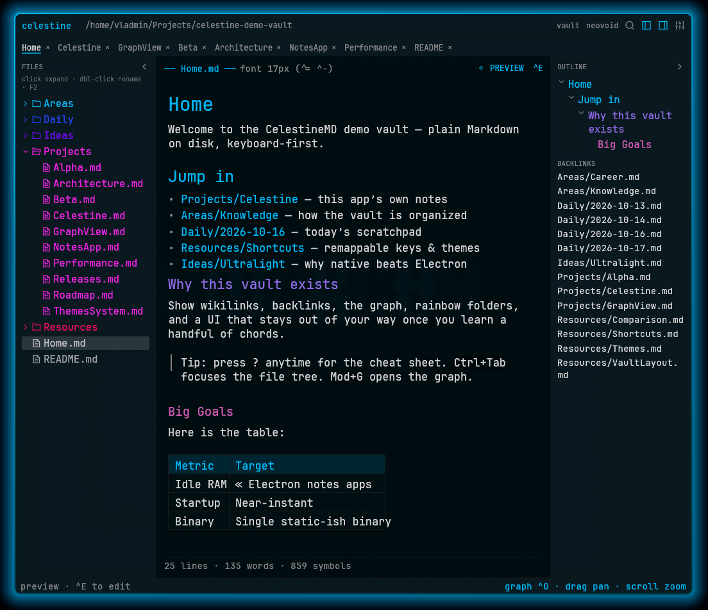
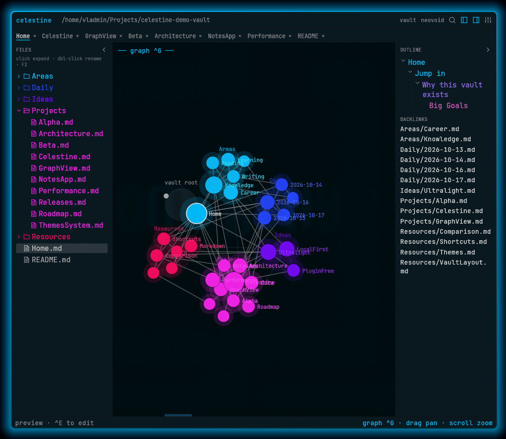
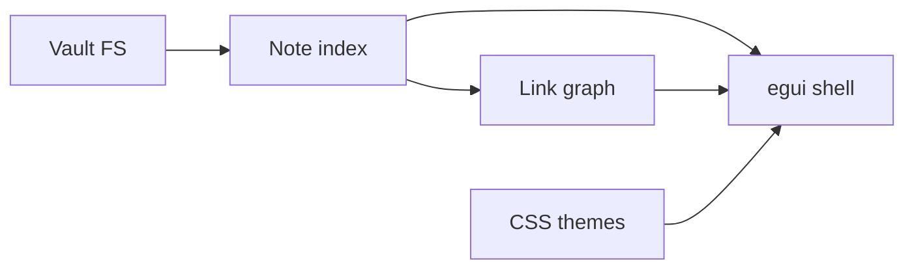
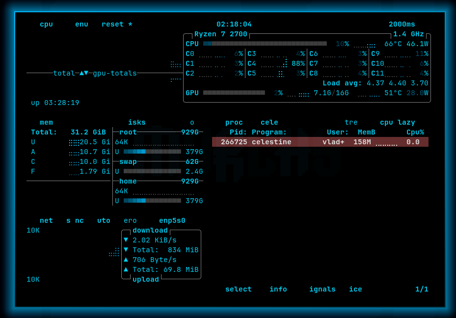

<p align="center">
  
</p>

<h1 align="center">CelestineMD</h1>

<p align="center">
  <strong>Local Markdown notes. Native Rust. Ultralight.</strong>
</p>

<p align="center">
  An open-source knowledge base inspired by Obsidian — wikilinks, graph, backlinks.<br/>
  <strong>Keyboard-first</strong> so the GUI can get out of your way · <strong>highly customizable</strong> themes &amp; keybinds so it works <em>just for you</em>.
</p>

<p align="center">
  <a href="#install"></a>
  <a href="#features"></a>
  <a href="docs/INSPIRATION.md"></a>
  <a href="#license"></a>
  
  
</p>

<p align="center">
  <a href="#why-celestine">Why</a> ·
  <a href="#features">Features</a> ·
  <a href="#install">Install</a> ·
  <a href="#keyboard-first">Shortcuts</a> ·
  <a href="#themes">Themes</a> ·
  <a href="#architecture">Architecture</a> ·
  <a href="#celestine-vs-obsidian">vs Obsidian</a> ·
  <a href="docs/INSPIRATION.md">Inspiration</a> ·
  <a href="#support-the-project">Donate</a>
</p>

---

<table>
  <tr>
    <td align="center" width="50%">
      <br/>
      <sub><strong>Editor</strong> — <code>neovoid</code> · files · outline · backlinks</sub>
    </td>
    <td align="center" width="50%">
      <br/>
      <sub><strong>Graph</strong> (<code>Mod+G</code>) — folder-tinted clusters</sub>
    </td>
  </tr>
</table>

---

## Why Celestine?

Most note apps either ship Electron bloat or lock you into a proprietary store.

**CelestineMD** is a small native app inspired by the Obsidian workflow — not a rewrite of it:

| | |
|---|---|
| **Your vault stays yours** | Plain Markdown on disk. Open any folder of notes. |
| **Native & fast** | Pure Rust (`egui`/`eframe`) — no Chromium tax. |
| **Inspired, not cloned** | Familiar ideas (wikilinks, graph, backlinks); Celestine’s own UI and scope. |
| **Keyboard-first** | Heavy on shortcuts — file tree, tabs, graph, rename, sidebars — so the GUI can shrink out of your way. |
| **Made for you** | Remappable TOML keybinds + CSS theme packs (folder rainbows, heading colors). Shape the app around *your* habits. |
| **Honest UI** | Flat flea chrome. No ribbon farm. No plugin bazaar (by design). |
| **~4× lighter RAM** | ~162&nbsp;MB vs ~644&nbsp;MB Obsidian — see [Celestine vs Obsidian](#celestine-vs-obsidian). |

---

## Features

### Core knowledge loop
- **File tree** — rainbow folders, custom marks, click expand, double-click / F2 rename, `Ctrl+Tab` toggles files ↔ editor
- **Fuzzy quick open** — `Ctrl/Cmd+O`
- **Command palette** — `Ctrl/Cmd+P`
- **Wikilinks** `[[Note]]`, aliases, heading jumps, embeds `![[…]]`
- **Outline** from headings + **backlinks** pane
- **Graph view** — `Ctrl/Cmd+G` (clustered, folder-tinted)
- **Edit + reading preview** — `Ctrl/Cmd+E` (syntax tint in editor)
- **Vault search** — `Ctrl/Cmd+Shift+F`
- Multi-tab notes, nav back/forward, reveal-in-tree

### Themes & keys
- Built-in **CSS custom-property** packs with distinct folder/heading palettes
- **`omarchy`** theme follows the active [Omarchy](https://omarchy.org) desktop theme (`colors.toml`) and updates live on `omarchy theme set`
- Remappable TOML keybindings — Obsidian + Omarchy-friendly profiles
- Color emoji via system fonts
- **Canvas** boards (`.canvas`, [JSON Canvas](https://jsoncanvas.org)): nib-pen ink, text / note / image cards, arrows between anything, pixel dot grid — see [docs/INSPIRATION.md](docs/INSPIRATION.md#canvas)

### Deliberately skipped (for now)
Plugins · Sync · Obsidian-style Live Preview WYSIWYG · arbitrary community theme engines

---

## Install

### Linux (one-liner)

```bash
curl -fsSL https://raw.githubusercontent.com/nek0pi/celestine-md/main/packaging/install-from-release.sh | bash
celestine ~/Notes
```

Installs the latest **x86_64** release into `~/.local` (binary, desktop entry, icons, themes). Ensure `~/.local/bin` is on your `PATH`.

### Homebrew (macOS / Linuxbrew)

```bash
brew tap nek0pi/celestine
brew install celestine-md
brew upgrade celestine-md   # after each new formula bump
# or build from git HEAD:
brew install --HEAD nek0pi/celestine/celestine-md
```

Tap: [nek0pi/homebrew-celestine](https://github.com/nek0pi/homebrew-celestine).

### Arch Linux (AUR)

```bash
yay -S celestine-md
# or: paru -S celestine-md
```

Available after the AUR package is published (see [`docs/RELEASE.md`](docs/RELEASE.md)). PKGBUILD: [`packaging/aur/PKGBUILD`](packaging/aur/PKGBUILD).
### Prebuilt archives (Linux / macOS / Windows)

Tagged releases ship **Linux x86_64**, **macOS** (Intel + Apple Silicon), and **Windows x86_64**:

**[github.com/nek0pi/celestine-md/releases](https://github.com/nek0pi/celestine-md/releases)**

```bash
# Linux / macOS example
tar -xzf celestine-linux-x86_64-v0.3.1.tar.gz
./celestine-linux-x86_64/install.sh          # → ~/.local/bin/celestine
celestine ~/Notes
```

Windows: unzip and run `celestine.exe` (first launch may show SmartScreen until binaries are signed).

### From source

```bash
git clone https://github.com/nek0pi/celestine-md.git
cd celestine-md
cargo build -p celestine-app --release
./packaging/install-user.sh   # Linux: binary + desktop + icons + themes → ~/.local
celestine ~/Notes
```

### Requirements
- Rust stable (for source builds)  
- Linux: OpenGL / Wayland or X11 libs for `eframe`  
- macOS / Windows: supported via GitHub Actions release builds

```bash
cargo test --workspace
```

Maintainer release guide (tags, CI, Brew/AUR): [`docs/RELEASE.md`](docs/RELEASE.md).

---

## Keyboard-first (and yours to reshape)

Celestine is built so **hands stay on the keyboard**: chords are printed in the status bar and overlays, the file tree is fully traversable without the mouse, and almost every action lives in the command palette (`Mod+P`). The GUI is there when you need it — and easy to hide when you don’t (`Mod+B` / `Mod+\`).

Mod = **Ctrl** on Linux/Windows, **Cmd** on macOS.

| Shortcut | Action |
|----------|--------|
| `Mod+O` | Quick file open |
| `Mod+P` | Command palette |
| `Mod+G` | Graph view |
| `Mod+T` | Theme picker |
| `Mod+E` | Toggle edit / preview |
| `Mod+S` / `Mod+N` / `Mod+W` | Save / new note / close tab |
| `Alt+←` / `Alt+→` | Previous / next tab |
| `Ctrl+Tab` | Toggle files ↔ editor (↑↓←→ · Enter · F2 in tree) |
| `F2` / `Mod+Shift+N` | Rename / new folder |
| `Mod+B` / `Mod+\` | Toggle files / outline sidebars |
| `Mod+[` / `Mod+]` | Navigate back / forward |
| `Mod+Shift+E` | Reveal note in tree |
| `Mod+Shift+F` | Search vault |
| `?` / `Mod+/` | Shortcuts cheat sheet |

**Customize it:** copy [`config/keybindings.omarchy.toml`](config/keybindings.omarchy.toml) → `~/.config/celestine/keybindings.toml`, pick a theme with `Mod+T` or `CELESTINE_THEME=…`, and keep only the chords that match *your* muscle memory. Omarchy profile (auto-detected): `Ctrl+1..9` jump tab, no `Super` binds.

Full map: [`docs/INSPIRATION.md`](docs/INSPIRATION.md).

---

## Themes

Ship-ready packs in [`themes/`](themes/):

`obsidian-dark` · `obsidian-light` · `catppuccin` · `tokyo-night` · `gruvbox-dark` · `gruvbox-light` · `nord` · `solarized-dark` · `solarized-light` · `dracula` · `rose-pine` · `everforest-dark` · **`neovoid`** · `one-dark` · `monokai` · `kanagawa` · `ayu-dark` · `oxocarbon` · `high-contrast` · **`omarchy`** (Omarchy hosts only)

```bash
CELESTINE_THEME=neovoid celestine ~/Notes
```

Themes are **CSS custom properties** (`--background-primary`, …) parsed into UI tokens — editable, portable, no Electron required. Each pack gets its own folder rainbow and heading colors so themes actually feel different.

### Try the demo vault

A sample vault (wikilinks, folders, graph-ready) lives **outside** this git repo:

```bash
CELESTINE_THEME=neovoid celestine ~/Projects/celestine-demo-vault
```

Open `Home.md`, press `Mod+G` for the graph, `?` for the cheat sheet.

<p align="center">
  
</p>

---

## Architecture

```
celestine/
├── crates/celestine-core/     # vault, parse, index, resolve, graph
├── crates/celestine-theme/    # CSS-var packs + Omarchy bridge
├── crates/celestine-app/      # egui desktop shell
├── themes/                    # built-in *.css
├── config/                    # default keybinding profiles
└── assets/icon/               # crystal mark (SVG + PNG sizes)
```



---

## Celestine vs Obsidian

Same idea (local Markdown vaults) — different engine. Obsidian runs on **Electron** (Chromium). Celestine is a **native Rust** GUI (`egui` / `eframe`) with no browser runtime.

Measured on the same machine (light editing / idle with a small vault):

| | **CelestineMD** | **Obsidian** | Why it matters |
|---|---|---|---|
| **RAM (RSS)** | ~**162 MB** | ~**644 MB** | ~**4×** less memory in `btop` |
| **On disk** | ~**31 MB** single binary | ~**25 MB** app + ~**336 MB** Electron ≈ **360 MB** | One native binary vs a Chromium runtime |
| **Startup** | Near-instant | A couple of seconds of Electron boot | Open a vault like opening a terminal |
| **CPU (idle)** | Near-idle | Chromium + renderer keep humming | Less heat, less fan |
| **Surface area** | Core loop only (by design) | Plugins, sync marketplace, ribbon farm | Less to learn, less to break |

<p align="center">
  <br/>
  <sub><strong>btop</strong> — Celestine ~162&nbsp;MB RSS while editing the demo vault (Obsidian idle ~644&nbsp;MB on the same box)</sub>
</p>

Numbers move with vault size and Obsidian plugins, but the shape stays: **drop Electron, keep the Markdown.** Celestine stays intentionally small so that light footprint remains a feature, not a temporary phase.

---

## Inspiration

CelestineMD is **inspired by** Obsidian’s local-vault workflow — not a clone. Current scope, shortcuts, and intentional non-goals: [`docs/INSPIRATION.md`](docs/INSPIRATION.md).

---

## Contributing

Issues and PRs welcome. Keep changes focused; match the ultralight / keyboard-first tone.

1. `cargo test --workspace`  
2. Don’t add plugin-host surface area without an explicit RFC  
3. Prefer Celestine’s own design over chasing Obsidian feature parity  
4. Keep [`docs/INSPIRATION.md`](docs/INSPIRATION.md) accurate when behavior changes meaningfully  

---

## License

[MIT](LICENSE) — free as in crystal-clear.

---

## Support the project

Celestine stays **MIT**, local-first, and deliberately light. If it helps your vault — and you’d like to keep development moving (performance, themes, keyboard workflows, more features without Electron weight) — donations are welcome:

<p align="center">
  <a href="https://buymeacoffee.com/nekopi">
    
  </a>
</p>

<p align="center">
  <strong><a href="https://buymeacoffee.com/nekopi">buymeacoffee.com/nekopi</a></strong>
</p>

<p align="center">
  <sub>Thanks — it directly funds keeping Celestine light and feature-rich for everyone.</sub>
</p>

---

<p align="center">
  <sub>Built for people who love their Markdown vaults and hate waiting for Chromium to boot.</sub>
</p>
